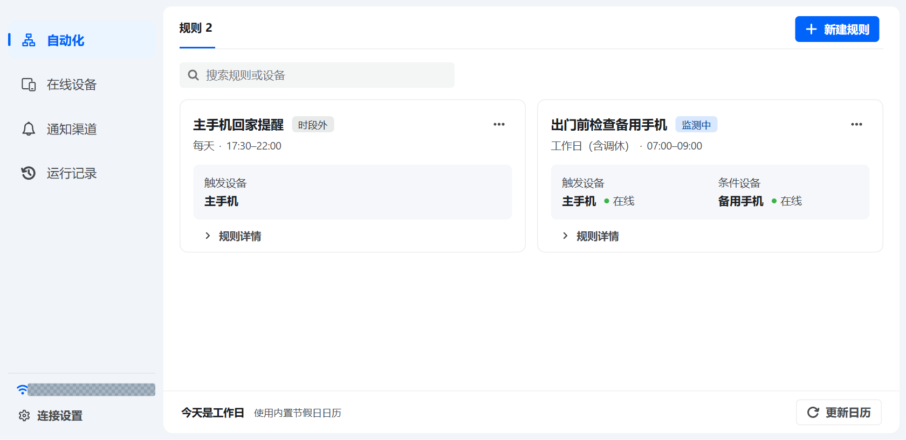
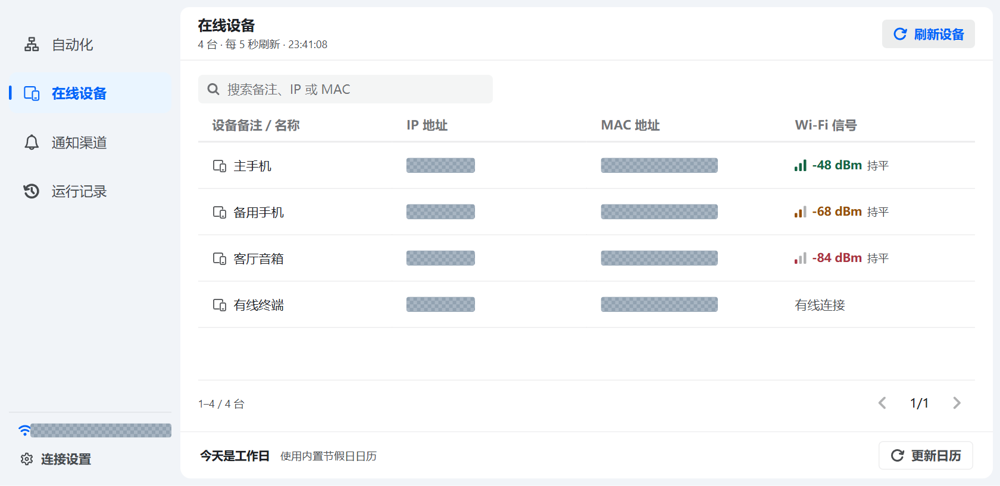
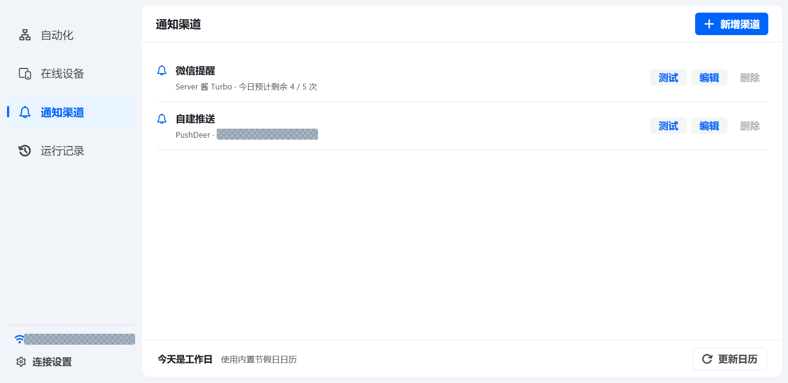

<div align="center">
  
  <h1>离网自动化</h1>
  <p>让飞牛 NAS 在设备离开或回到局域网时，给手机发一条提醒。</p>
  <p><strong>fnOS 1.1.3100+</strong> · 锐捷 eWeb · Server 酱 Turbo / PushDeer</p>
</div>

最初想解决的是一个很小的问题：工作日早上，主手机已经离开 Wi-Fi，备用手机却还连在家里。这时让 NAS 发来一句「出门前记得带上备用手机」。两台手机一起离开，就安静放行。

> [!IMPORTANT]
> **安装前先确认路由器。** 当前内置适配器读取锐捷 eWeb 的实时在线终端列表。即使同为锐捷，不同型号和固件的登录流程、终端接口也可能不同。使用其他路由器时，需要针对自己的型号和固件适配，再配置规则。详见[路由器适配指南](docs/router-adaptation.md)。



## 从安装到第一条提醒

1. 在飞牛应用中心安装 **Node.js 22**。准备好 `lan-automation.fpk` 后，选择「手动安装」，导入并启动应用。自行生成安装包的方法见下方「开发与打包」。
2. 以飞牛管理员身份打开应用，填写路由器的**内网 IPv4 地址**和管理密码。连接后，去「在线设备」核对目标设备。规则以 MAC 地址识别设备，设备更换该网络使用的随机 MAC 后需要重新选择。
3. 在「通知渠道」新增至少一个渠道，点击「测试」，在手机上确认收到。一个规则可以选一个或多个渠道。
4. 在「自动化」选择「使用模板」。触发设备选主手机，设为「从在线变为离线」。条件设备选备用手机，设为「触发前后仍在线」。
5. 选择工作日和生效时段，再选择通知渠道并保存。验证时可临时选一个覆盖当前时间的时段，让两台设备先保持在线，再断开主手机的 Wi-Fi。在「运行记录」查看规则和各渠道的执行结果。

**关闭飞牛里的应用窗口后，NAS 会继续检测。** 在应用中心停止应用，检测和推送才会停止。设备离线的判定取决于路由器何时把它移出在线列表。

## 设备、时间和通知

| 功能 | 行为 |
| --- | --- |
| 在线设备 | 按备注、IP 或 MAC 搜索。无线路由器上报 RSSI 时显示三格信号、dBm 和相邻采样的变化，有线设备单独标注。 |
| 触发与条件 | 支持上线或离线触发，可要求多个条件全部满足或满足其一。「仍在线」会核对变化前后的两次状态。 |
| 生效时间 | 每天或中国法定工作日，支持多时段、跨午夜。按北京时间判断，跨午夜时段归属开始当天。 |
| 连续确认 | 默认每 10 秒采样一次，连续确认 2 次。间隔可设 1～300 秒，确认次数可设 1～10 次。读取路由器失败会重置本次确认。 |
| 通知与记录 | 可以自定义提醒文案，每个渠道单独记录投递结果。「服务已受理」表示推送接口已接受请求，手机收件情况需在接收端确认。 |

<details>
<summary><strong>查看在线设备和通知渠道界面</strong></summary>





</details>

截图使用虚构设备和演示规则，网络地址已遮挡。

### 选哪个通知渠道

| 渠道 | 在飞牛中填写 | 接收方式 |
| --- | --- | --- |
| Server 酱 Turbo | SendKey、该 Key 的每日额度 | 在 Server 酱网站选择接收通道。应用显示的「今日预计剩余」按北京时间统计本应用发起的请求，含测试请求；其他应用共用 Key 时，以服务端记录为准。[Server 酱](https://sct.ftqq.com/) |
| 自建 PushDeer | 服务地址、PushKey | 在自己的 PushDeer 实例绑定接收设备；填写服务根地址，应用会向该实例的 `/message/push` 提交消息。[PushDeer 部署文档](https://github.com/easychen/pushdeer) |

### 工作日日历

随包附带 2026、2027 年日历。服务启动时以及此后每 24 小时尝试更新当年和下一年的数据，也可在界面点击「更新日历」。下载失败时优先使用缓存或内置数据，缺少年份数据时暂按周一至周五判断，界面会显示提示。[日历数据来源](https://github.com/NateScarlet/holiday-cn)

## 凭据和隐私

- 路由器管理密码、SendKey 和 PushKey 以**明文**保存在飞牛应用私有目录 `$TRIM_PKGVAR/data/settings.json`。应用以独立账户运行，新建数据目录权限为 `0700`，配置文件为 `0600`。设置页面不会回显已保存的密钥。拥有系统管理权限或可读取备份的人仍可读取这些值。
- 当前锐捷适配器通过局域网 HTTP 与路由器通信，登录表单对密码做编码加密，HTTP 连接本身没有 TLS 保护。请在可信管理网络中使用。自建 PushDeer 跨网络访问时使用 HTTPS。
- 设备匹配和规则判断在 NAS 上完成。触发时，所选推送服务会收到标题和正文，自动生成的正文可能含设备备注。运行记录存于同一私有目录下的 `events.json`。
- 提 Issue 时可以提供型号、固件版本、现象和脱敏后的字段示例。请勿上传路由器抓包、完整配置、运行数据、真实 MAC、Cookie、会话令牌或推送密钥。

## 开发与打包

在仓库根目录运行以下命令。本地构建推荐使用 **Node.js 22.12 或更高的 22.x 版本**。

```sh
npm ci
npm run build
npm start
```

打开 `http://127.0.0.1:5180/app/lan-automation/`。开发服务默认只监听本机，数据写入已被 Git 忽略的 `.local-data/`。飞牛安装版通过应用网关和 Unix Socket 访问。

生成 FPK 时，先将飞牛的 `fnpack` 加入 PATH，或通过环境变量 `FNPACK` 指定其可执行文件。Windows 打包还需要能以 `python` 调用的 Python 3，用于写入包内的 Linux 文件权限。[飞牛 fnpack 文档](https://developer.fnnas.com/docs/cli/fnpack/)

```sh
npm run build
npm run package
```

产物为 `build/lan-automation.fpk`，可作为 GitHub Release 附件分发。Windows 本地打包已使用 fnpack 1.2.3 验证。

| 想修改的部分 | 源码入口 |
| --- | --- |
| 路由器登录与设备映射 | [server/router.mjs](server/router.mjs) |
| 规则检测、工作日和跨午夜判断 | [server/monitor.mjs](server/monitor.mjs) · [server/calendar.mjs](server/calendar.mjs) |
| 通知渠道和消息文案 | [server/channels.mjs](server/channels.mjs) · [server/notice.mjs](server/notice.mjs) |
| 界面和规则编辑器 | [src/](src/) |
| 飞牛清单、服务生命周期和打包 | [package/](package/) · [scripts/](scripts/) |

## 许可与致谢

项目原创代码采用 [MIT 许可证](LICENSE)。界面使用 React、Semi Design 及其图标库，通过飞牛 Web SDK 接入桌面。第三方组件遵循各自许可，内置节假日数据保留了 [holiday-cn 的版权与许可](calendar/LICENSE)。
